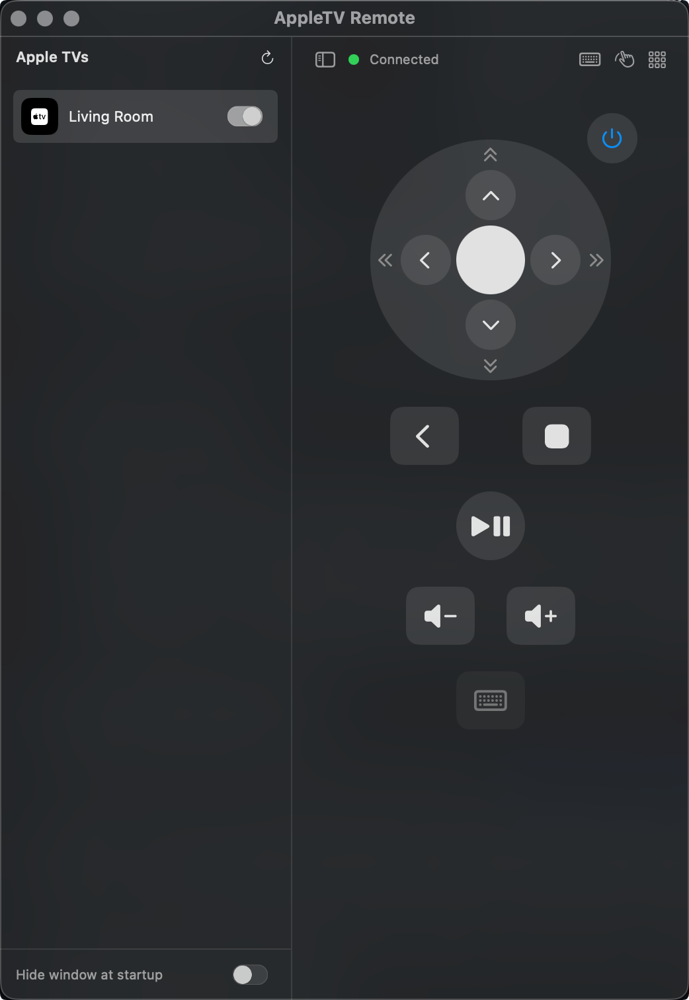
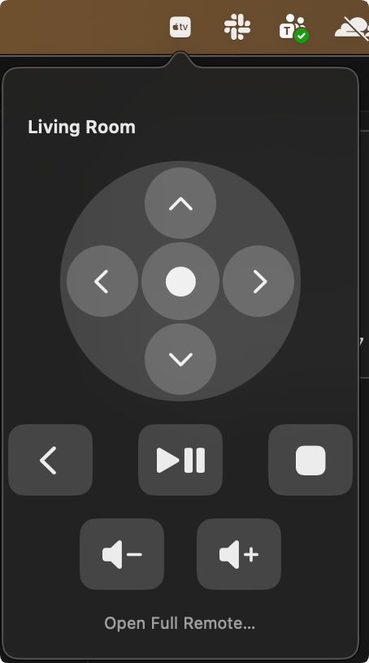
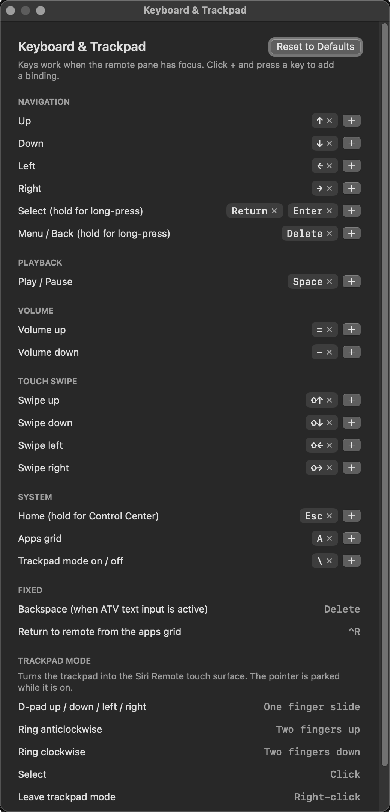
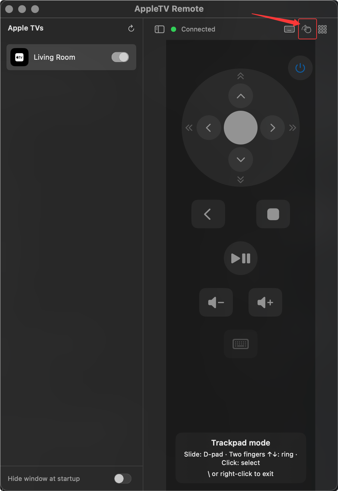

#  Apple TV Remote

A macOS app that discovers and controls Apple TVs on the local network via the **Companion** and **Media Remote Protocol (MRP)** protocols. Includes a full-featured main window with device sidebar and remote control UI, and a scriptable `atv` CLI companion tool.

## Features

- **Menu bar app** — lives in the menu bar; popover remote for quick access, with the same keyboard shortcuts as the main window
- **Main window** — collapsible device sidebar + remote control pane with D-pad, playback, volume, now-playing
- **Customizable key bindings** — remap every remote action to the keys you prefer in **Keyboard & Trackpad…**
- **Trackpad mode** — use the MacBook trackpad as the Siri Remote touch surface (slide for D-pad, two fingers for the ring, click to select)
- **App launcher** — browse and launch apps installed on the Apple TV
- **Keyboard text input** — type into active Apple TV text fields from the Mac
- **`atv` CLI** — scriptable control from the terminal or shell scripts
- **Auto-reconnect** — reconnects automatically when the Apple TV becomes reachable
- **Keyboard shortcuts** — `A` to open app grid, `⌃R` to return to remote, arrow keys to navigate apps; full list in the menu-bar icon's right-click menu

## Screenshots

### Main window

The device sidebar on the left, the remote on the right. The status bar at the top holds the keyboard-input, trackpad-mode, and app-launcher buttons.



### Menu bar popover

Click the menu bar icon for a compact remote. Keyboard shortcuts work here too: arrow keys, `Return`, `Delete`, `Esc`, `Space`, and the rest of your bindings drive the Apple TV while the popover is open, and the buttons flash to confirm each key press. The `A` (apps grid) key opens the main window on the app launcher, since the popover has no grid of its own.



### Keyboard & Trackpad settings

Right-click the menu bar icon and choose **Keyboard & Trackpad…**. Click **+** next to an action and press a key to add a binding; click **×** to remove one; **Reset to Defaults** restores the stock layout. The window also lists the fixed keys and the trackpad gestures.



### Trackpad mode

Press `\` or click the hand icon in the status bar (highlighted below). The trackpad becomes the Siri Remote touch surface and an on-screen hint shows the gestures. Right-click or press `\` again to leave.



### More views

| Remote (`remote.png`) | Remote + sidebar (`remote with sidebar.png`) |
|--------|-----------------|
|  |  |

| App grid (`appgrid.png`) | App grid + sidebar (`appgrid with sidebar.png`) |
|----------|--------------------|
|  |  |

## Install

Grab the latest signed + notarized DMG from the
**[Releases page](https://github.com/alokdhir/appletv-remote/releases/latest)**.

1. Download `AppleTVRemote-X.Y.Z.dmg`.
2. Double click to mount and open
3. Drag `AppleTVRemote.app` onto the `Applications` shortcut.
4. *(Optional)* For the `atv` CLI: open a Terminal in the mounted DMG and run `./install.sh` — copies the app to `/Applications` and the CLI to `/usr/local/bin/atv` in one go.
5. Launch from `/Applications` (or run `atv help` from the terminal).

## Requirements

- macOS 13+
- Apple TV on the same local network
- Xcode 26 / Swift 6 *(only if you want to build from source)*

### Optional dependencies

- **[terminal-notifier](https://github.com/julienXX/terminal-notifier)** — improves keyboard-input notifications. Without it the app falls back to `osascript display notification`, which appears attributed to "Script Editor" and opens Script Editor when clicked. With terminal-notifier, notifications show the AppleTVRemote icon and clicking focuses the app.

  ```bash
  brew install terminal-notifier
  ```

  > **Note:** The first time a notification fires, macOS will open System Settings → Notifications and ask you to explicitly allow terminal-notifier to send notifications. Do that once and notifications will work from then on.

## Building from source

If you'd rather build it yourself than use the prebuilt DMG above.

### Swift (recommended — builds everything)

```bash
# Debug build (fast, for development)
swift build

# Release build (optimised, for daily use)
swift build -c release

# Run tests
swift test
```

Builds the GUI app, the `atv` CLI, all modules, and tests.

### Xcode

```bash
xcodebuild -project AppleTVRemote.xcodeproj -scheme AppleTVRemote -configuration Release
```

Builds only the `AppleTVRemote.app` GUI target. Use this path for archiving, signing, and notarizing for distribution.

### Installing a local build

After `swift build -c release`, copy the binaries into place:

```bash
cp -f .build/release/AppleTVRemote /Applications/AppleTVRemote.app/Contents/MacOS/AppleTVRemote
cp -rf .build/release/AppleTVRemote_AppleTVRemote.bundle /Applications/AppleTVRemote.app/Contents/Resources/
cp -f .build/release/atv /usr/local/bin/atv
codesign --force --deep --sign - /Applications/AppleTVRemote.app
```

> **Note:** Always copy both the binary *and* the `.bundle` — the bundle contains
> bundled app icons and other resources that SwiftUI's `Bundle.module` reads at runtime.

### Cutting a release (maintainer only)

The full signed + notarized DMG pipeline is automated in `scripts/`.

```bash
# Build a signed + notarized DMG, no upload.
scripts/build-dmg.sh

# End-to-end: tag, build, push, attach to GitHub release.
scripts/release.sh v1.2.0
```

`build-dmg.sh` auto-detects the Developer ID Application identity in your
keychain and the `appletv-remote-notarization` notarytool profile. First-time
setup (cert, app-specific password, `notarytool store-credentials`) is
described in the script header.

## Pairing

Launch the app, select your Apple TV from the sidebar, and click **Connect**. The Apple TV will display a 4-digit PIN — enter it in the pairing dialog. Credentials are saved automatically.

```bash
# Or pair from the CLI
atv pair "Living Room"
```

## `atv` CLI Reference

```bash
# Discovery & setup
atv list               # list discovered Apple TVs
atv status             # connection state + now-playing
atv pair <name>        # pair with an Apple TV (prompts for PIN)
atv select <name>      # set default device for subsequent commands

# Navigation
atv u / d / l / r      # D-pad up / down / left / right
atv click              # D-pad centre (select)
atv menu               # menu / back
atv home               # home button
atv sl / sr / su / sd  # trackpad swipe left/right/up/down

# Playback & volume
atv pp                 # play/pause
atv vol+ / vol-        # volume up/down
atv power              # wake if asleep, sleep if on

# App launcher
atv apps               # list installed apps
atv launch <bundleID>  # launch an app by bundle ID

# Chaining
atv 3 r                # repeat right × 3
atv r u d              # right, then up, then down

# Standalone mode (no app required — connects directly)
atv --standalone apps
atv --standalone --device "Living Room" l
```

## Keyboard Controls

### Remote control pane

These keys work in the main window's remote pane and in the menu bar popover. In the popover, `A` opens the main window on the app launcher, and `\` (trackpad mode) has no effect because trackpad mode lives in the main window.

| Key | Action |
|-----|--------|
| `↑ ↓ ← →` | D-pad up / down / left / right |
| `⇧ ↑ ↓ ← →` | Trackpad swipe up / down / left / right |
| `Return` / `Enter` | Select _(hold for long-press)_ |
| `Delete` | Menu / Back _(hold for long-press)_; deletes the last character instead while an Apple TV text field is active |
| `Esc` | Home _(hold for Control Center)_ |
| `Space` | Play / Pause |
| `=` / `-` | Volume up / down |
| `A` | Open app launcher |
| `\` | Trackpad mode on / off |
| `⌃ R` | Return to remote |

These are the defaults. Every binding except `⌃ R` can be changed in **Keyboard & Trackpad…** (menu-bar icon's right-click menu): click **+** on an action and press a key. `⌘` chords and `Tab` can't be bound.

### Trackpad mode

`\` (or the hand icon in the remote pane's status bar) turns the trackpad into the Siri Remote touch surface. The pointer is parked while the mode is on.

| Gesture | Action |
|---------|--------|
| One-finger slide in the top / bottom / left / right area | D-pad up / down / left / right _(keeps repeating as you slide)_ |
| Two-finger slide up / down | Clickpad ring anticlockwise / clockwise |
| Click | Select |
| Right-click or `\` | Leave trackpad mode |

A slide starting in the centre of the trackpad follows the slide direction instead. **Keyboard & Trackpad…** can switch all slides to follow direction.

### App launcher pane

| Key | Action |
|-----|--------|
| `↑ ↓ ← →` | Navigate app grid |
| `Return` | Launch selected app |
| `Tab` | Focus search field |
| `⌃R` / `A` | Return to remote (`A` only outside the search field) |

## Credential Storage

Pairing credentials (Ed25519 long-term key pair + Apple TV public key) are stored as JSON in:

```
~/Library/Application Support/AppleTVRemote/<device-id>.json         # Companion
~/Library/Application Support/AppleTVRemote/<device-id>.airplay.json # AirPlay
```

**Security note:** The Ed25519 private key (`ltsk`) is stored in plaintext. The files are written with `0600` permissions (owner read/write only).

## Architecture

### `Sources/AppleTVRemote/` — SwiftUI app

| File | Role |
|------|------|
| `AppleTVRemoteApp.swift` | `@main` entry point; owns `DeviceDiscovery`, `AutoReconnector` |
| `DeviceDiscovery.swift` | Bonjour browser (`_companion-link._tcp`) using `NWBrowser` |
| `ContentView.swift` | Root split layout (collapsible sidebar + detail) |
| `DeviceListView.swift` | Sidebar: device list, auto-connect toggles |
| `RemoteControlView.swift` | D-pad, playback, volume, now-playing card, app launcher toggle |
| `AppLauncherView.swift` | App grid with search, keyboard navigation, responsive columns |
| `MenuBarController.swift` | Menu bar status item, popover, right-click menu |
| `AppIconCache.swift` | Fetches and caches app icons from iTunes + bundled system icons |
| `KeyboardNotificationManager.swift` | Manages keyboard-input notifications for Apple TV remote requests |
| `KeyboardShortcutsWindow.swift` | Key-binding editor + trackpad options window (menu-bar right-click → Keyboard & Trackpad…) |
| `KeyBindings.swift` | `RemoteAction`, `KeyChord`, and `KeyBindingStore` (user key bindings, persisted in UserDefaults) |
| `TrackpadSurface.swift` | Trackpad mode: raw trackpad touches → D-pad presses and ring rotation |
| `PopoverActivationGuard.swift` | Suppresses the first tap that activates the popover window |
| `VisualEffectBackground.swift` | NSVisualEffectView wrapper for SwiftUI translucency |
| `CompanionConnection.swift` | App-layer orchestrator: TCP connect/disconnect, WoL, pairing delegation, `@Published` state for SwiftUI |
| `IPCServer.swift` | Unix socket IPC server for `atv` CLI |
| `AutoReconnector.swift` | Watches for unexpected disconnects and retries |
| `WindowManagement.swift` | NSWindow setup: translucency, focus-fade, hide-on-close |

### `Sources/AppleTVProtocol/` — Core protocol library (reusable, no UI dependencies)

`AppleTVProtocol` has no dependency on SwiftUI, AppKit, or this app. It can be embedded in other Swift projects (CLI tools, server-side daemons, other apps) to drive Apple TV Companion sessions directly.

| File | Role |
|------|------|
| `AppleTVDevice.swift` | Device model, `ConnectionState`, `RemoteCommand` enums |
| `CompanionSession.swift` | Live session: socket I/O, frame dispatch, keepalive, all feature send methods |
| `CompanionFrame.swift` | Wire frame encode/decode |
| `CompanionPairVerify.swift` | HAP pair-verify over Companion protocol framing |
| `PairingFlow.swift` | Pair-setup (SRP-6a) state machine |
| `EncryptedFrameTransport.swift` | ChaCha20-Poly1305 seal/open for E_OPACK frames |
| `OPACK.swift` | OPACK binary encoder/decoder |
| `NowPlayingInfo.swift` | `NowPlayingInfo` struct: now-playing snapshot, live-elapsed interpolation, album filter |
| `NowPlayingMerge.swift` | `NowPlayingMergeInput` / `NowPlayingMergeResult` and `NowPlayingInfo.merging(_:)` |
| `MRPDecoder.swift` | Decodes MRP now-playing protobuf messages |
| `MRPMessage.swift` | Constructs MRP wire messages (varint-length-prefixed protobuf frames) |
| `MRPDataChannel.swift` | MRP data channel over AirPlay connection |
| `AirPlayTunnel.swift` | AirPlay MRP tunnel for real-time now-playing |
| `AirPlayHTTP.swift` | Minimal HTTP/1.1 client for AirPlay long-lived TCP connections |
| `AirPlayPairing.swift` | AirPlay pair-setup and pair-verify (SRP + TLV8) |
| `AirPlayEventChannel.swift` | AirPlay event channel over established session |
| `EncryptedAirPlayRTSP.swift` | RTSP-over-ChaCha20-Poly1305 transport post pair-verify |
| `HAPPairing.swift` / `SRPClient.swift` | HAP pairing crypto |
| `HAPSession.swift` | Bidirectional ChaCha20-Poly1305 frame codec for AirPlay sockets |
| `TLV8.swift` | HAP TLV8 encoder/decoder |
| `CredentialStore.swift` | Pairing credentials persisted as JSON in Application Support |
| `MACStore.swift` | Persists Apple TV MAC addresses for Wake-on-LAN when device is asleep |
| `WakeOnLAN.swift` | Magic packet broadcast |
| `RTITextOperations.swift` | RTI binary plist encoder for text input |
| `BinaryPlist.swift` | Minimal binary plist (bplist00) writer for NSKeyedArchiver UID references |
| `CryptoUtils.swift` | Shared crypto utilities (Data extensions) |
| `PrimaryInterface.swift` | Resolves the primary network interface for socket binding |

### `Sources/AppleTVIPC/` — Shared IPC wire types

| File | Role |
|------|------|
| `IPCProtocol.swift` | IPC protocol between app and `atv` CLI |

### Protocol overview

- Apple TVs advertise `_companion-link._tcp` via Bonjour; port is resolved dynamically
- Pairing: SRP-6a (HAP-style) + Ed25519 long-term keys, OPACK-framed
- Session: ChaCha20-Poly1305 encrypted OPACK frames over raw TCP
- App launcher: `FetchLaunchableApplicationsEvent` over the established Companion session
- AirPlay MRP tunnel: encrypted RTSP → DataStream → MRP protobuf for now-playing metadata

## Acknowledgements

This project would not have been possible without **[pyatv](https://github.com/postlund/pyatv)** by [Pierre Ståhl](https://github.com/postlund) and contributors.

pyatv is an open-source Python library that reverse-engineered and documented Apple's proprietary Apple TV protocols — including the Companion protocol, OPACK binary format, HAP-style pairing, and the AirPlay MRP tunnel. It served as the primary protocol reference throughout the development of this project.

Many thanks to the pyatv project and contributors for their work documenting undocumented protocols and making that knowledge freely available.

> pyatv is licensed under the MIT License.
> https://github.com/postlund/pyatv
